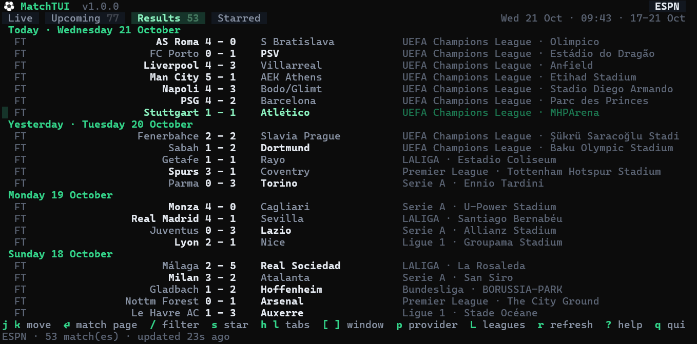
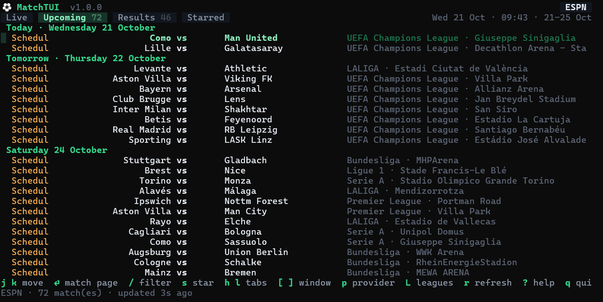
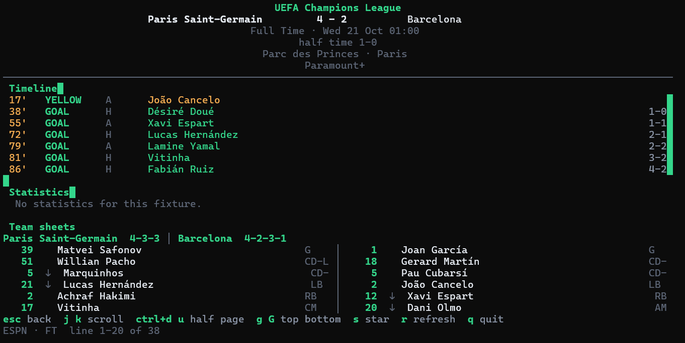
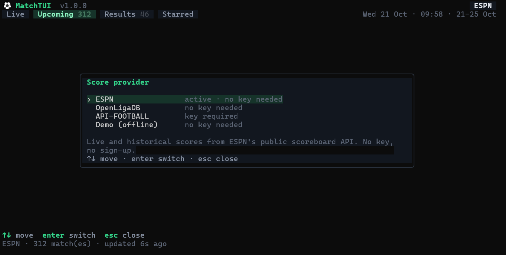

# MatchTUI

A terminal dashboard for football fixtures: **live scores**, **upcoming kick-offs**,
**past results** and a **watchlist**, with several data providers you can switch
between without leaving the app.

```
⚽ MatchTUI                                                      ESPN
 Live 4   Upcoming 10   Results 24   Starred   Wed 21 Oct · 02:51 · 17-21 Oct
 Today · Wednesday 21 October
  FT     AS Roma              4 - 0    S Bratislava    UCL · Stadio Olimpico
  FT     Man City             5 - 1    AEK Athens      UCL · Etihad Stadium
 Yesterday · Tuesday 20 October
  FT     Fenerbahce           2 - 2    Slavia Prague   UCL · Sukru Saracoglu
  FT     Sabah                1 - 2    Dortmund        UCL · Bank Respublika
 Monday 19 October
  FT     Real Madrid          4 - 1    Sevilla         LALIGA · Santiago Bernabeu

 ⏎ opens the fixture in a panel on the right, with the timeline split into a
 column per team and the statistics mirrored around the centre.
```

## Screenshots

Four views of the same session, in the order you meet them: browse the fixtures,
open one, then change the feed underneath it. Click any image for full size.

<table>
  <tr>
    <td width="50%" align="center">
      <br>
      <sub><b>Results</b> &mdash; finished scores, newest first</sub>
    </td>
    <td width="50%" align="center">
      <br>
      <sub><b>Upcoming</b> &mdash; kick-offs grouped by day</sub>
    </td>
  </tr>
  <tr>
    <td width="50%" align="center">
      <br>
      <sub><b>Match panel</b> &mdash; <code>&#9166;</code> opens a fixture beside the list</sub>
    </td>
    <td width="50%" align="center">
      <br>
      <sub><b>Provider picker</b> &mdash; <code>p</code> switches feeds</sub>
    </td>
  </tr>
</table>

## Why a provider you can switch

Live scores are only useful if the feed behind them is up. MatchTUI ships four
providers and lets you change the active one with a single key:

| Provider       | Key needed | Coverage                                   | Rate limit hint |
| -------------- | ---------- | ------------------------------------------ | --------------- |
| **ESPN** *(default)* | no         | 29 competitions worldwide, live + history, team sheets  | none            |
| **OpenLigaDB**      | no         | German leagues, DFB-Pokal, UEFA competitions | none          |
| **API-FOOTBALL**    | yes        | Full fixture, stat and timeline coverage   | 15 min          |
| **Demo (offline)**  | no         | Simulated fixtures and team sheets that tick along | none     |

ESPN is the default because it needs no sign-up and covers the widest set of
competitions. OpenLigaDB is a genuinely free community feed and a good second
opinion. API-FOOTBALL is for when you want deeper statistics: the free tier at
[api-sports.io](https://dashboard.api-sports.io) allows about 100 requests a
day, so MatchTUI automatically throttles its polling to one request every
15 minutes while that provider is active. The demo provider is always available
so the app is useful before you have configured anything.

## Install

MatchTUI is a single static binary with no runtime dependencies.

### Linux

From a checkout, the installer builds and puts it on your `PATH`:

```sh
./install.sh                      # build and install to ~/.local/bin
sudo ./install.sh                 # build and install to /usr/local/bin
PREFIX=$HOME/bin ./install.sh     # install somewhere else
./install.sh --skip-tests         # skip the test run during the build
```

It needs [Go](https://go.dev/dl/) 1.24 or newer to build, and nothing else at
run time. If `~/.local/bin` is not on your `PATH` the installer tells you the
line to add.

Already have a binary? Just run it:

```sh
chmod +x matchtui-linux-x86_64    # or matchtui-linux-aarch64 on ARM
./matchtui-linux-x86_64
```

To build rather than install:

```sh
./build.sh              # checks plus a build for this machine
./build.sh --linux      # cross compile dist/matchtui-linux-{x86_64,aarch64}
./build.sh --skip-tests # skip the test run
```

`build.sh` refuses to build if `gofmt` or `go vet` complain, so a release
candidate is always clean.

### Windows

```powershell
git clone <this repository>
cd matchtui
powershell -NoProfile -ExecutionPolicy Bypass -File .\build.ps1   # produces dist\matchtui.exe
.\dist\matchtui.exe
```

Or straight from source:

```powershell
go install .
matchtui
```

### macOS

```sh
./install.sh             # same script, detects Darwin and names the artifact accordingly
make build               # or the Makefile route: produces bin/matchtui
```

### Prebuilt binaries

`dist/` may already contain binaries for the common targets:

| File | Target |
| ---- | ------ |
| `matchtui-linux-x86_64` | Linux, Intel/AMD 64-bit |
| `matchtui-linux-aarch64` | Linux, ARM 64-bit (Raspberry Pi 4+, Apple Silicon under Docker) |
| `matchtui.exe` | Windows, Intel 64-bit |

All are built with `CGO_ENABLED=0` and stripped, so they are fully static and
have no libc or terminal library requirements.

Requires Go 1.24 or newer to build. Windows Terminal (the default console on
Windows 11) is recommended; the classic conhost works too, but renders accents
less well. On Linux any terminal works, though one with true colour support
(foot, kitty, alacritty, WezTerm, GNOME Terminal, Windows Terminal) shows the
palette properly.

## Keys

| Key | Action |
| --- | ------ |
| `↑` `↓` or `j` `k` | move the selection |
| `⏎` or `i` | open the match panel beside the list |
| `h` `l`, `←` `→`, `tab`, `1`-`4` | switch between Live, Upcoming, Results and Starred |
| `g` `gg`, `G` | jump to the top or bottom of the list or panel |
| `ctrl+d` `ctrl+u` | half a page down or up |
| `ctrl+f` `ctrl+b`, `pgup` `pgdn` | a full page down or up |
| `[` `]` | shift the upcoming/results window a few days further or back |
| `/` | filter by team, competition or venue |
| `s` | star or unstar the selected match |
| `r` | refresh now |
| `p` | switch score provider (`k` inside the menu sets that provider's key) |
| `L` | choose which competitions to load |
| `K` | set the API key for the current provider |
| `?` | show or hide the help overlay |
| `esc` | close the match panel, or clear the filter |
| `q` | close the match panel, or quit |

Movement keys follow vim: `j` and `k` move, `gg` and `G` jump, and `ctrl+d`/`ctrl+u`
scroll by half a page. Whichever window has focus owns them, so scrolling the
match panel never moves the list underneath it.


## Behaviour

- **Live** refreshes automatically (30 seconds by default) and shows a countdown
  in the header. Only today's matches are re-fetched, so polling stays cheap.
- **Upcoming** and **Results** load a window of days (5 by default) that you can
  move with `[` and `]`. They are cached for five minutes.
- **Starred** collects every match you press `s` on, and the list is persisted,
  so it survives a restart.
- Pressing `⏎` opens the fixture in a **side panel** on the right, about two
  thirds of the screen wide; the list stays visible and usable beside it. `esc`
  puts it away again. The panel stays pinned to the fixture you opened even if a
  refresh reshuffles the list underneath it.
- Inside the panel the two sides get a column each: the timeline is split home
  left and away right, statistics put each team's value on its own edge with
  mirrored bars in between, and the team sheets stand side by side.
- The layout adapts to the terminal. Narrow terminals (a phone running Termux,
  for instance) drop the competition column from the list and give the panel the
  whole width; short terminals drop the status line so the list keeps its rows.
- Every frame is clipped to the terminal size, so resizing mid-flight never
  leaves artefacts.

## Configuration

Settings live in the platform config directory, so they work from any working
directory. On first run MatchTUI creates the file and the directory if needed.

| Platform | Path |
| -------- | ---- |
| Linux | `~/.config/matchtui/config.json` |
| Windows | `%AppData%\matchtui\config.json` |
| macOS | `~/Library/Application Support/matchtui/config.json` |

```json
{
  "provider": "espn",
  "refresh_seconds": 30,
  "upcoming_days": 5,
  "results_days": 5,
  "leagues": { "espn": ["eng.1", "esp.1", "uefa.champions"] },
  "api_keys": { "apifootball": "your-free-api-key" },
  "starred": ["espn|eng.1|393|359|2026-10-17T14:00:00Z"],
  "color_scheme": "auto"
}
```

The same values can be set on the command line, which is handy for a one-off:

```
matchtui -provider demo
matchtui -color dark
matchtui -refresh 120
matchtui -version
```

`color_scheme` accepts `auto`, `light` or `dark`; `auto` follows your terminal.

## Development

```sh
go build ./...     # compile
go vet ./...       # static checks
go test ./...      # offline tests plus live feed checks
go test -short ./...   # skip the network tests

./build.sh              # checks plus a build for this machine
./build.sh --linux      # cross compile both Linux targets
powershell -NoProfile -ExecutionPolicy Bypass -File .\build.ps1   # same, on Windows

go test ./internal/ui -run TestPreview -v            # print rendered frames
go test ./internal/ui -run TestMatchPagePreview -v   # print the match page
```

The test suite is split so the default `go test ./...` also exercises the real
feeds: it verifies that ESPN and OpenLigaDB still parse, that real club names
never overflow the layout, and that ESPN still returns team sheets. Use `-short`
when you want a purely offline run.

Cross compiling is the whole build story here: the binary is pure Go with
`CGO_ENABLED=0`, so a Linux target builds fine from Windows and vice versa.

### Layout

```
main.go                     entry point and flags
internal/model              provider-agnostic match types
internal/config             config load/save, starred list, API key vault
internal/provider           provider interface and the four implementations
internal/ui                 Bubble Tea model, rendering and layout
build.sh / install.sh       build and install on Linux and macOS
build.ps1                   the same on Windows
Makefile                    make build, test, install, clean
```

Providers only have to turn their feed into `model.Match`; the UI never knows
which API it is talking to. Adding a feed means writing one file in
`internal/provider` and registering it in `provider.Builtin`.

## Notes

- No account, tracker or telemetry of any kind. Requests go straight from your
  machine to the chosen feed.
- The API key you enter is stored in your config file in plain text, exactly as
  you would for any local CLI. Use `-provider espn` if you would rather not
  store one at all.
